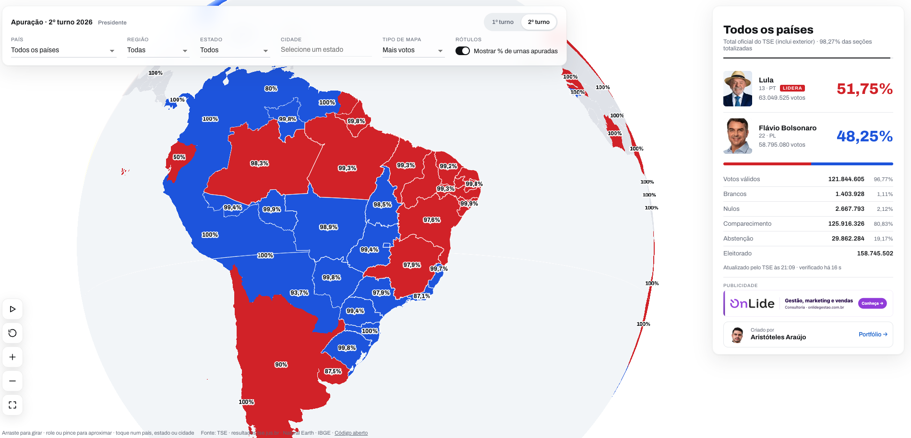
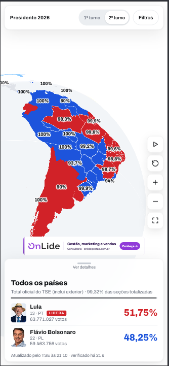

# Apuração 2º turno 2026 · Globo ao vivo

A apuração da eleição presidencial de 2026 num **globo 3D interativo**, atualizado ao vivo com os dados do TSE.

**Ao vivo:** <https://eleicoes2turno.tapp.solutions>

<p>
  
</p>
<p align="center">
  
</p>

## O que o site faz

- **2º turno ao vivo:** cada área (país, estado, município, cidade do exterior) é dividida em
  vermelho (Lula, à esquerda) e azul (Flávio Bolsonaro, à direita) na proporção dos votos. O tipo
  de mapa **Mais votos** pinta a área inteira com a cor de quem lidera, e um rótulo opcional mostra
  o **% de urnas apuradas** de cada área. Detalhes: [`docs/filtros-mapa.md`](docs/filtros-mapa.md).
- **1º turno** (`?turno=1`): resultado final dos 12 candidatos, servido como snapshot estático e
  com cada área na cor do vencedor. Detalhes: [`docs/primeiro-turno.md`](docs/primeiro-turno.md).
- **Filtros País → Região → Estado → Cidade:** a câmera voa até o recorte escolhido.
- **Atualização a cada 30 s com animação:** números contam do valor antigo ao novo, e a divisão e
  as cores do globo deslizam (respeita `prefers-reduced-motion`). Na tela aparece "verificado há X s",
  e o site atualiza ao voltar para a aba. Detalhes: [`docs/animacoes.md`](docs/animacoes.md).
- **Contador de pessoas online**, sem cookie nem dado pessoal: [`docs/contador-online.md`](docs/contador-online.md).
- **Faixa de aviso:** publicada pelo operador via API (sem deploy) ou automática quando o TSE fica
  mais de 10 min sem atualizar. Detalhes: [`docs/avisos.md`](docs/avisos.md).
- **Selo ELEITO e faixa de vencedor**, só a partir das marcações do TSE, nunca de uma conta nossa:
  [`docs/eleito.md`](docs/eleito.md).
- Em **português, inglês e espanhol**.

## Dados

Todos os números vêm dos arquivos públicos do TSE em `resultados.tse.jus.br` (eleição `6258`,
cargo Presidente; o 1º turno é a eleição `6257`). O TSE só divulga a partir das 17h de Brasília;
antes disso o site mostra "aguardando divulgação".

- O total oficial é o de **Todos os países** (arquivo do Brasil, que inclui o exterior).
- "Brasil" sozinho, regiões e países do exterior são **somas** (das UFs ou das cidades), sempre rotuladas.
- O TSE não agrupa o exterior por país: a tabela cidade → país é nossa (`data/abroad_countries.py`).
- Geometrias: IBGE (estados e municípios) e Natural Earth (países), simplificadas em `data/build_geo.py`.
- Snapshot do 1º turno: `data/fetch_r1.py` + `data/build_r1.py` geram `web/public/data/r1/`.

## Arquitetura

Um único container: a API em Go faz o polling do TSE, guarda tudo em memória e serve a API e o site.

```
api/   Go (Clean Architecture): domain (entities, usecases, services, repositories)
       infra (tse client/parser, cache) · presentation (handlers, middlewares, routes) · pkg
web/   Vite + TypeScript: domain · infra (API, geometria, interface do globo)
       external (adapter MapLibre GL) · presenter (cards, controles, anúncios) · i18n (pt/en/es)
data/  scripts que geram as geometrias, a tabela do exterior e o snapshot do 1º turno
```

- **Polling:** Brasil e UFs a cada 30 s; cidades do exterior a cada 4 ciclos. Os 5.570 municípios
  são varridos com 1 requisição por vez, 500 ms entre arquivos e `If-Modified-Since` (o TSE
  responde 304 quando nada mudou).
- **Respeito ao TSE:** depois de um 429 o cliente fica em silêncio por 1 min, dobrando até 10 min,
  e respeita `Retry-After` (`api/internal/infra/tse/client.go`).
- **Pico de acesso:** as respostas são pré-serializadas e pré-comprimidas, com `ETag` e
  `Cache-Control` pensado para CDN.
- **Segurança:** CSP estrita, HSTS, limite de requisições por IP, CORS restrito, usuário não-root.
  O único segredo é `NOTICE_ADMIN_TOKEN`, que vem só do ambiente; o resto da configuração é público.

## API

Tudo sob `/api/v1`, com limite de requisições por IP (30 req/s, rajada de 60).

| Rota | Uso |
|---|---|
| `GET /summary` | Brasil, UFs, exterior, países, candidatos (com `elected`/`status`) e metadados de atualização |
| `GET /uf/{uf}/municipalities` | Resultados dos municípios de uma UF (sigla minúscula) |
| `GET /abroad/cities` | Resultados das cidades do exterior |
| `GET /config` | Configuração pública do site (anúncios) |
| `POST /presence` | Batimento da aba aberta (`{"id":"<id aleatório da aba>"}`); responde `{"online": n}`. Ver [`docs/contador-online.md`](docs/contador-online.md) |
| `GET /notice` | Aviso atual (`{"notice": {...}}` ou `{"notice": null}`), público |
| `PUT /notice` | Publica o aviso (`title`, `body`, `linkUrl`, `linkLabel`). Exige `Authorization: Bearer <NOTICE_ADMIN_TOKEN>` |
| `DELETE /notice` | Retira o aviso. Mesmo token. Sem token configurado, `PUT`/`DELETE` respondem 404. Ver [`docs/avisos.md`](docs/avisos.md) |
| `GET /healthz` | Healthcheck (fora de `/api/v1`) |

## Rodar localmente

```bash
# API (porta 8080) — precisa de internet para falar com o TSE
cd api && go run ./cmd/api

# Web com hot reload (proxy de /api para a porta 8080)
cd web && npm ci && npm run dev
```

Testes: `cd api && go test -race ./...` · `cd web && npm test`

Container: `docker build -t eleicoes2turno . && docker run -p 8080:8080 eleicoes2turno`

## Variáveis de ambiente

Veja `.env.example`. As principais:

| Variável | Padrão | Uso |
|---|---|---|
| `PORT` | `8080` | Porta HTTP |
| `ALLOWED_ORIGIN` | `https://eleicoes2turno.tapp.solutions` | CORS da API |
| `TRUST_CLOUDFLARE` | `false` | `true` quando o Cloudflare faz proxy (usa `CF-Connecting-IP` no limite de requisições) |
| `FAST_INTERVAL` | `30s` | Intervalo do ciclo rápido |
| `MUN_CONCURRENCY` | `1` | Requisições simultâneas ao TSE na varredura de municípios |
| `MUN_PACE` | `500ms` | Pausa após cada requisição da varredura (o TSE bloqueia clientes que pedem demais) |
| `ABROAD_EVERY` | `4` | Atualiza as cidades do exterior a cada N ciclos rápidos |
| `NOTICE_ADMIN_TOKEN` | vazio | Liga `PUT`/`DELETE /api/v1/notice`. Segredo: só no ambiente, nunca no repositório |
| `NOTICE_TITLE` / `NOTICE_BODY` / `NOTICE_LINK_URL` / `NOTICE_LINK_LABEL` | vazio | Aviso semeado no boot (sobrevive a restart); sem `NOTICE_TITLE`, nenhum |
| `ADSENSE_CLIENT` | vazio | ID de publisher (`ca-pub-…`); liga o AdSense e o `/ads.txt` |
| `ADSENSE_SLOT_RESULTS` / `ADSENSE_SLOT_MOBILE` | vazio | Blocos de anúncio |
| `HOUSE_AD_IMAGE` / `HOUSE_AD_LINK` / `HOUSE_AD_ALT` | banner da Tapp | Banner próprio, mostrado quando o AdSense não está configurado |

## Deploy (Coolify)

1. Crie uma aplicação a partir deste repositório usando o **Dockerfile**, com a porta `8080`.
2. Healthcheck: `GET /healthz`. A imagem já define `HEALTHCHECK` com `wget`.
3. Domínio: `https://eleicoes2turno.tapp.solutions`.
4. Recomendado para picos de acesso: Cloudflare na frente, com proxy ligado, e `TRUST_CLOUDFLARE=true`.
5. Rode **uma réplica**, porque cada réplica faz o próprio polling do TSE.

## Bastidores: o que aprendemos

**Do zero ao ar em ~43 minutos.** O primeiro commit foi às 13:11 do dia da eleição e o site estava
no ar por volta das 13:54. Até as 22:15 foram 24 commits e 13 deploys, ~5,4 mil linhas de código e
~5,5 mil de testes (315 testes web e ~90 em Go). Fizemos com IA (Claude Code), com agentes em
paralelo: um implementando, outro monitorando a produção, outro fazendo deploy. A decisão de
produto ficou comigo.

**Respeite a fonte de dados.** O TSE limita requisições por IP (HTTP 429), e na primeira hora o
servidor foi bloqueado por consultar rápido demais. Passamos a ir com calma: 1 requisição por vez,
500 ms entre arquivos de município, exterior a cada 4 ciclos, GET condicional (`Last-Modified`) e
silêncio automático depois de um 429 (1 min, dobrando até 10 min, respeitando `Retry-After`).
Depois disso, nenhum bloqueio.

**O imprevisto faz parte do produto.** Às 17:02 o STF prorrogou a votação até as 19h e o TSE pausou
a divulgação em 0,25%. Em minutos criamos o sistema de avisos (publicado sem deploy, protegido por
token) e o aviso automático para quando o TSE passa de 10 min sem atualizar. Na retomada, às 19:01,
o aviso saiu.

**Mostre que está vivo.** Um amigo achou que o site tinha travado, quando quem estava parado era o
TSE. "verificado há X s" e a atualização ao voltar para a aba resolveram a percepção.

**Confie no dado oficial, não na conta.** "ELEITO" só aparece por marcação do TSE: o campo `e` do
candidato ou `md: "e"` no arquivo (que entendemos como "matematicamente definido"; o campo não é
documentado). Nunca inferimos o vencedor pela matemática do site.

**Estado em memória tem custo.** Cada deploy reinicia o servidor, que busca tudo de novo no TSE
(~10 s sem dados). Funcionou, mas da próxima vez vamos persistir o último snapshot.

**Cache de CDN engana.** O banner antigo continuou aparecendo por causa do Browser Cache TTL do
Cloudflare (4h). A solução foi versionar o nome do arquivo.

**Animar em vez de "pipocar".** Números e cores do globo fazem transição (cores misturadas em OKLab),
com orçamento de quadro (se um quadro passa de 24 ms, a animação pula para o fim) e respeito a
`prefers-reduced-motion`.

**O público acompanha a apuração.** O pico foi de 52 pessoas simultâneas às 20:29, com ~51% das
urnas apuradas. A audiência cresceu na retomada e caiu rápido depois de 96%. Esses números são só
de simultâneos; o total de visitantes vem do Cloudflare.
<!-- TODO: números do Cloudflare -->

**O que faríamos diferente:**

- persistir o último snapshot;
- liberar o script de analytics na CSP desde o início;
- ter o sistema de avisos pronto antes do dia.

## Licença

MIT. Os dados são do TSE (públicos), as malhas geográficas são do IBGE e os países são do Natural Earth (domínio público).
